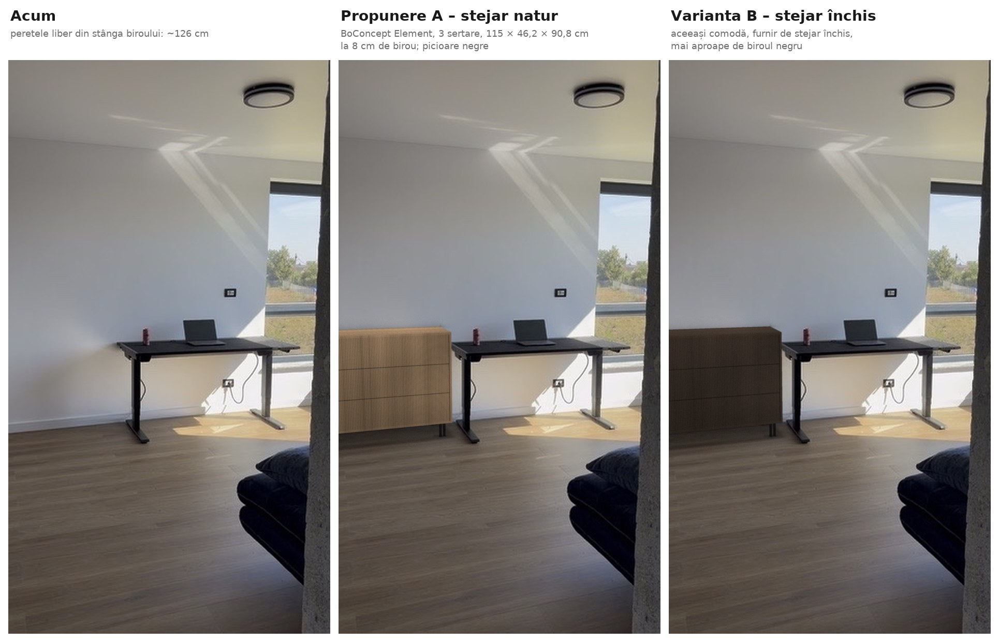
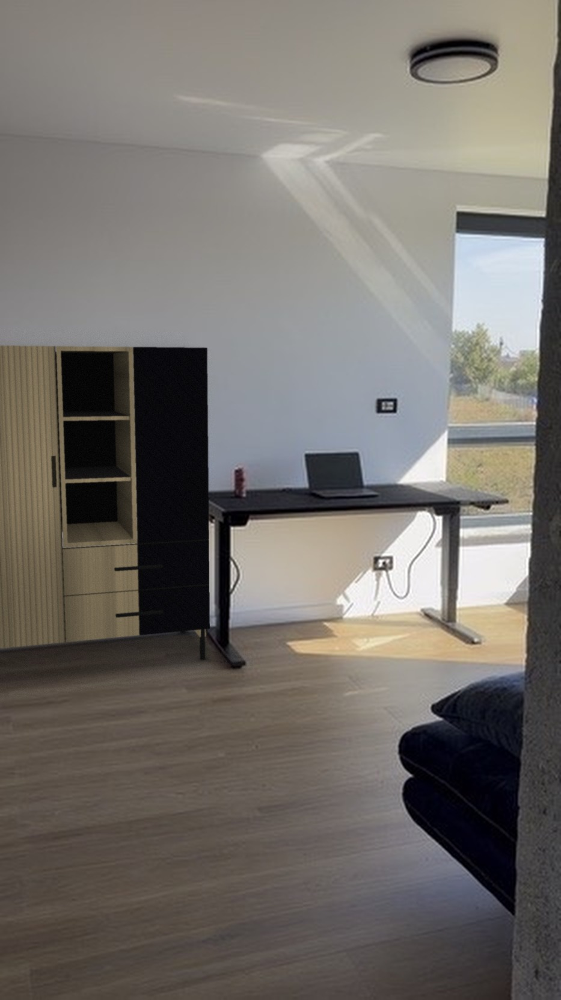
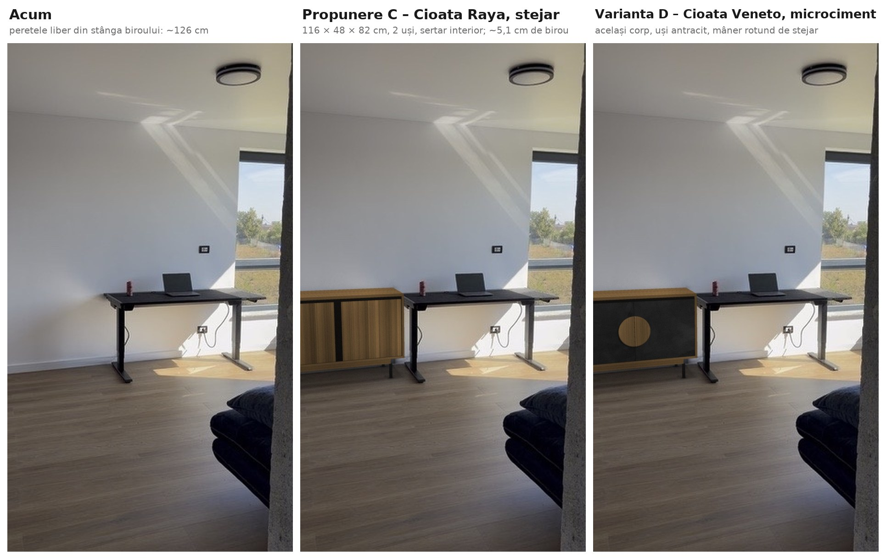

# Comodă birou

[Înapoi la prezentarea generală](../README.md)

O comodă cu sertare în Dormitor 2, în stânga biroului Secretlab MAGNUS Pro de 1,5 m, pe peretele cu fereastra de colț. E comoda BoConcept Element cu 3 sertare, de 115 × 46,2 × 90,8 cm: furnir de stejar, fronturi cu riflaj vertical, sertare fără mânere, care se deschid prin apăsare (push-to-open), și picioare duble negre, ca ale biroului. Stă la 8 cm de birou, lipită de perete, deasupra plintei, și se prinde de perete cu banda anti-răsturnare din cutie. Propunerea A e în stejar natur, iar varianta B, în stejar închis.

Variantele C și D sunt de la Cioata: bufetele Raya 116 și Veneto 116, din stejar masiv, cu un sertar în spatele ușilor. Le găsești [mai jos](#variantele-c-și-d-de-la-cioata), cu randările, planul tehnic și lista lor de materiale. Nu le înlocuiesc pe A și B.

## Conținutul folderului

| Fișier | Conținut |
|---|---|
| [comparatie_acum_vs_propuneri.jpg](comparatie_acum_vs_propuneri.jpg) | Situația actuală, propunerea A (stejar natur) și varianta B (stejar închis) |
| [propunere_A_stejar.jpg](propunere_A_stejar.jpg) | Randarea propunerii A |
| [varianta_B_stejar_inchis.jpg](varianta_B_stejar_inchis.jpg) | Randarea variantei B |
| [alternativa_cioata_galla_120.jpg](alternativa_cioata_galla_120.jpg) | Dulapul Cioata Galla 120, despre care ai întrebat, în același loc, pentru comparație (vezi [Alternative analizate](#alternative-analizate)) |
| [plan_tehnic_comoda_birou.pdf](plan_tehnic_comoda_birou.pdf) | Planul tehnic A3, scara 1:15: vedere frontală, plan și secțiune; detaliul A (prinderea anti-răsturnare) și detaliul B (plinta și picioarele) la 1:5; planul camerei la 1:50, cu ușa; notele și cotele de măsurat ([PNG](plan_tehnic_comoda_birou.png)) |
| [lista_materiale.md](lista_materiale.md) | Lista de cumpărături, cu prețuri și linkuri |
| [comparatie_acum_vs_propuneri_cioata.jpg](comparatie_acum_vs_propuneri_cioata.jpg) | Situația actuală, propunerea C (Cioata Raya) și varianta D (Cioata Veneto) |
| [propunere_C_cioata_raya.jpg](propunere_C_cioata_raya.jpg) | Randarea propunerii C |
| [varianta_D_cioata_veneto.jpg](varianta_D_cioata_veneto.jpg) | Randarea variantei D |
| [plan_tehnic_comoda_birou_cioata.pdf](plan_tehnic_comoda_birou_cioata.pdf) | Planul tehnic A3 al variantelor C și D, scara 1:15: vedere frontală cu C, plan cu ușile deschise și sertarul scos, secțiune prin bufet și fața lui D; planul camerei la 1:50; notele și cotele de măsurat ([PNG](plan_tehnic_comoda_birou_cioata.png)) |
| [lista_materiale_cioata.md](lista_materiale_cioata.md) | Lista de cumpărături pentru C și D, cu prețuri verificate și linkuri |

## Ce e acum lângă perete

| Ce | Model | Dimensiuni |
|---|---|---|
| Birou | Secretlab MAGNUS Pro 1,5 m, metal | blat de 150 × 70 cm, cu înălțimea reglabilă electric între 65 și 125 cm |
| Fereastra Fe-06 | fereastră de colț, continuată de Fe-07 pe fațadă | 108 × 180 cm în plan, parapet de 47 cm |
| Întrerupător și priză | deasupra și dedesubtul biroului, spre fereastră | nu sunt în zona comodei |

Dimensiunile biroului sunt din [pagina Secretlab de comparație a birourilor](https://secretlab.eu/pages/compare-desks); ale ferestrei, din planul etajului.

## Cote măsurate

Cota dată de tine: înălțimea camerei, 250 cm.

Din planul etajului, pentru Dormitor 2 (E 03, 12,01 m²):
- camera are 327 × 366 cm; peretele cu biroul are 366 cm;
- golul ferestrei Fe-06 începe la 278,9 cm de colțul din stânga, cel cu peretele spre Dormitor 1;
- ușa UI-02, de 90 × 210 cm, e pe peretele opus, spre hol, și se deschide spre peretele dinspre Dormitor 1, departe de comodă.

PDF-ul planului nu e la scara din cartuș: scrie 1:50, dar desenul e la ~1:52,2. Scara reală am luat-o din cota de 327 cm și am verificat-o pe cea de 366 cm.

Cotele estimate din fotografie, cu „~”, trebuie verificate cu ruleta. Fotografia a fost calibrată pe tavanul de 250 cm, pe marginea ferestrei din plan și pe blatul biroului de 150 × 70 cm. Scara vine din tavan: fotografia singură nu-l poate da, pentru că la alt tavan biroul s-ar muta față de perete, cu aceeași eroare. Cu 250 cm, biroul iese lipit de perete, cum se vede în poză; lipit de tot ar fi la un tavan de ~251 cm, deci cota ta se potrivește. Fiecare centimetru de tavan mută biroul cu ~1 cm de-a lungul peretelui, așa că peretele liber se măsoară înainte de comandă. Din fotografie:
- biroul: de la ~126,2 la ~276,2 cm de colț, lipit de perete, cu blatul la ~75,8 cm;
- peretele liber dintre colț și birou: ~126,2 cm;
- plinta: ~8,5 cm înălțime;
- capul golului ferestrei: ~231,9 cm (planul dă 227 cm: 47 + 180);
- întrerupătorul de deasupra biroului, la ~116–126 cm înălțime, și priza de sub birou, la ~27–37 cm, sunt amândouă la ~233–246 cm de colț.

Primii ~30 cm de perete de lângă colț nu se văd în fotografie.

**Cote de măsurat**, înainte de comandă (sunt și pe plan):
1. Peretele liber dintre colț și birou, la nivelul plintei (~126,2 cm). Comoda are 115 cm, deci îți trebuie cel puțin ~120 cm.
2. Dacă pe perete, de la colț până la birou și până la 91 cm înălțime, e o priză, un întrerupător sau un termostat. Comoda le-ar acoperi.
3. Din ce e peretele și dacă trec cabluri la ~88 cm înălțime, unde se dă gaura pentru prinderea anti-răsturnare.
4. Plinta: înălțimea și grosimea. Corpul comodei începe la 13 cm, deci o plintă de până la ~12 cm rămâne liberă.

## Cum e gândit

- **O singură piesă, joasă, cu sertare.** Element are trei sertare mari, cu fronturi de ~24,5 cm, fără mânere: se deschid prin apăsare. Pe față rămân doar riflajul și rosturile dintre sertare.
- **Stejar și negru, ca restul camerei.** Furnir de stejar lăcuit și picioare duble din oțel negru, ca picioarele biroului și tâmplăria. Riflajul vertical al fronturilor se potrivește cu panoul riflaj de stejar din hol ([Cuier hol](../Cuier%20hol/README.md)).
- **Lângă birou, nu lipită de el.** La 8 cm de blat, biroul urcă și coboară liber, iar cablurile au loc pe lângă el. Spre colț rămân ~3 cm.
- **Înălțimea.** Cu cei 90,8 cm, comoda e cu ~15 cm peste blat când stai jos și sub el când lucrezi în picioare. Blatul ei e un loc bun pentru imprimantă, o lampă sau dosare.
- **Peste plintă.** Corpul începe la 13 cm, deasupra plintei de ~8,5 cm. Comoda stă lipită de perete, iar plinta nu se taie (detaliul B).
- **Sertarele ies spre cameră**, ~40 cm, nu spre birou; ușa camerei e pe peretele opus.
- **Prinsă de perete.** Producătorul cere prinderea anti-răsturnare. O bandă metalică din cutie se prinde în comodă, sub blat, iar capătul ei îndoit se prinde de perete, printr-un șurub care trece prin spatele comodei. Nu se vede din cameră (detaliul A).
- **Varianta B**, în stejar închis, se leagă mai bine de biroul negru. Propunerea A, în stejar natur, face colțul mai luminos.

## Alternative analizate

- **Cioata Galla 120 (GL650), despre care ai întrebat:** dulap cu 2 uși și 2 sertare, de 120 × 51 × 150 cm, la 8 899 lei. În imagine e în Natural Oak, cu contrast Nero. Încape doar la limită, din patru motive:
  1. **Lățimea:** cu 120 cm în ~126 cm liberi, rămân ~3,5 cm pe fiecare parte.
  2. **Ușile:** cea din stânga, de 51 cm, se deschide spre peretele din colț, iar cea din dreapta, de 34 cm, spre birou. Amândouă se opresc la ~90°. Deschisă complet, la ~110°, ușa din dreapta ar intra ~6 cm în blat: ea începe de la ~60 cm înălțime, iar blatul stă între 65 și 125 cm, deci mereu în dreptul ei. Ar trebui limitatoare de deschidere și cel puțin ~127 cm liberi.
  3. **Înălțimea:** 150 cm, dublu față de blat când stai jos și mai sus decât el chiar și când lucrezi în picioare.
  4. **Ce oferă:** e gândit pentru living sau dining, cu o nișă cu polițe de sticlă și spate de ceramică și doar 2 sertare, de 22 cm.

  Are și părți bune: e Cioata, ca comoda Veneto din living, are stejar și picioare negre, culoarea de contrast se alege (inclusiv Nero), iar corpul vine montat.
- **Cioata Atlas, comodă cu 2 sertare (AT300):** 70 × 48 × 78 cm, stejar masiv, 3 901 lei. Încape lejer și are aproape înălțimea blatului, dar are doar 2 sertare, iar spre colț rămân ~48 cm de perete gol.
- **Cioata Galla cu 6 sertare (136 cm) și Cioata Linea cu 6 sertare (130 cm):** prea late pentru ~126 cm. Cioata personalizează dimensiunile, deci le poți cere la ~115 cm; prețul se cere.
- **BoConcept Element cu 4 sertare:** 77 × 46,5 × 115,5 cm, 11 590 lei. Încape lejer, dar e cu ~40 cm peste blat când stai jos.
- **Altele:** Secretlab nu are un corp cu sertare pentru MAGNUS, doar sertare magnetice de sub blat, de la alți producători. USM Haller nu are dealer în România.

## Montaj pas cu pas

Comoda vine demontată, cu instrucțiunile BoConcept în desene: [corpul, sertarele și prinderea anti-răsturnare](https://assets.boconcept.com/cc724915-3b19-4063-8f42-b2cf00c225c4/943792140_v1_10_Original%20file.pdf) și [picioarele](https://assets.boconcept.com/bb389a74-9803-462e-882e-b2cf00c227b7/943792170_v1_Original%20file.pdf). Pe site, montajul e trecut ca ușor. Asamblată, comoda are 59 kg: o muți și o ridici cu încă o persoană. Pașii de mai jos urmează instrucțiunile și adaugă ce ține de camera ta: unde stă comoda și cum o prinzi de perete.

### Cote de montaj

| Ce | Cât |
|---|---|
| Comoda | 115 × 46,2 × 90,8 cm; corpul de 77,8 cm stă pe picioare de 13 cm |
| Distanța până la birou | 8 cm, între latura dreaptă a comodei și blat |
| Distanța până în colț | ~3,2 cm (rezultă din peretele liber de ~126,2 cm) |
| Distanța de la perete | 0: spatele corpului stă lipit de perete, iar corpul trece peste plintă |
| Gaura prin spatele comodei | cu burghiul BB din cutie, la 10 mm sub blat (~87,9 cm de pardoseală), pe la mijlocul lățimii |
| Gaura din perete | Ø6 mm, adâncă de 50 mm (fișa diblului cere cel puțin 45 mm), în dreptul găurii din spate |
| Șurubul din perete | 4,5 × 40 mm, Pozidriv PZ2, cel din punga diblului. Trece prin șaibă, bandă și spate (~5,5 mm) și intră ~34,5 mm în perete: lungimea diblului (30 mm) plus un diametru de șurub |
| Sertarele | ies ~40 cm spre cameră |

### Materiale și unelte

Materialele, cu prețuri și linkuri, sunt în [lista_materiale.md](lista_materiale.md):
- comoda, cu feroneria ei, ramele cu picioare și prinderea anti-răsturnare: banda AA, cu șurub și două șaibe, și burghiul BB;
- 2 dibluri Fischer DuoPower de 6 × 30 mm cu șurub de 4,5 × 40 mm (unul e de rezervă).

Unelte:
- șurubelniță Pozidriv PZ2 și șurubelniță dreaptă, plus un ciocan mic: în instrucțiuni apar toate trei;
- o șurubelniță PZ2 lungă, de ~30 cm, sau un prelungitor de biți: la pasul 9 ajungi la spatele comodei prin locul sertarului de sus, la ~45 cm adâncime;
- mașină de găurit cu percuție și burghiu de zidărie Ø6 mm, cu vârf din carbură. Burghiul BB din cutie e doar pentru spatele comodei;
- un cui lung sau o șurubelniță subțire, ca să marchezi peretele prin gaura din spate;
- detector de cabluri și țevi, ruletă, nivelă, creion, bandă de hârtie pentru burghiu;
- aspirator și o pătură sau cartonul din ambalaj, ca să nu zgârii parchetul și fronturile.

### 1. Înainte de comandă

1. Măsori cotele 1–4 de mai sus, de la „Cote măsurate”. Dacă peretele liber are sub ~120 cm, alege una dintre [alternative](#alternative-analizate).
2. Alegi finisajul: „Natural oak veneer” pentru A sau „Dark oak veneer” pentru B; ambele costă la fel. Dacă poți, le vezi pe viu în magazinul BoConcept din București.
3. Întrebi magazinul de termen și de costul livrării și al montajului. Pe pagina produsului scrie 6–7 săptămâni, pe pagina de livrare scrie 12–16 săptămâni pentru mobilierul din plăci, iar costurile nu apar pe site.

### 2. La livrare

1. Verifici coletele înainte să semnezi: cele două colete ale corpului, ramele cu picioare și cutiile de feronerie.
2. Le desfaci în Dormitor 2, pe pătură sau pe carton, aproape de locul comodei. Asamblată, comoda e grea și nu se mai cară ușor pe scări sau prin uși.
3. Sortezi feroneria după literele din instrucțiuni (A, B, C, … AA, BB) în capace sau pahare, înainte să începi.

### 3. Asamblează corpul

1. Urmezi figurile 1–7: excentricele și cepurile din blat și din fund, apoi laturile, spatele și glisierele.
2. Strângi excentricele ferm, dar nu la maximum: instrucțiunile arată 90 %.
3. Înainte să bați spatele în cuie (figura 6, pasul „Important”), măsori cele două diagonale ale corpului. Trebuie să fie egale; dacă nu sunt, împingi ușor de colțul mai lung până se egalează. Altfel, sertarele nu închid drept.

### 4. Prinde picioarele

1. Culci corpul pe spate, pe pătură.
2. Prinzi cele două rame cu picioare duble cu cele 14 șuruburi din punga lor, după instrucțiunile picioarelor.
3. Ridici comoda în picioare cu încă o persoană. Nu o târî pe picioare.

### 5. Sertarele

1. Asamblezi sertarele (figurile 8–11) și le împingi în glisiere până fac clic (figura 12).
2. Reglezi fronturile cu șuruburile de reglaj ale glisierelor (figura 12), până când rosturile sunt egale, de ~3 mm, iar fronturile sunt în același plan.
3. Eticheta de avertizare (pagina 8) rămâne lipită pe comodă.

### 6. Așază comoda

1. O duci la locul ei. Latura dreaptă stă la 8 cm de blatul biroului; măsori la ambele capete ale laturii, în față și în spate. Spatele stă lipit de perete.
2. Pui nivela pe blatul comodei, pe lungime și pe lățime. Dacă se clatină, lipești sub piciorul care nu atinge o pâslă subțire.
3. Ridici biroul până sus (125 cm), apoi îl cobori până jos (65 cm). Blatul nu trebuie să atingă comoda în nicio poziție.

### 7. Banda anti-răsturnare, în comodă

1. Scoți sertarul de sus; lucrezi prin locul lui.
2. Pasul 1 de la pagina 7 a instrucțiunilor: cu burghiul BB din cutie dai o gaură prin spatele comodei, la 10 mm sub blat. O dai pe la mijlocul lățimii, la ~57 cm de latura stângă.
3. Pașii 2–4: pui banda AA în comodă, cu partea dreaptă sub blat și capătul îndoit în jos, pe spate, cu gaura lui peste gaura din spate. O prinzi sub blat cu șurubul și o șaibă din cutie (pasul 4). A doua șaibă o păstrezi pentru șurubul din perete.

### 8. Gaura din perete

1. Împingi comoda la locul ei: lipită de perete, la 8 cm de birou.
2. Prin gaura benzii și a spatelui, marchezi peretele cu un cui lung sau cu o șurubelniță subțire. Semnul iese la ~88 cm de pardoseală.
3. Tragi comoda ~50 cm spre cameră și treci detectorul peste semn. Dacă găsește un cablu sau o țeavă, muți prinderea cu câțiva centimetri, pe aceeași înălțime: dai o gaură nouă prin spate, cu burghiul BB, și muți banda în dreptul ei.
4. Lipești banda de hârtie pe burghiul de Ø6 mm, la 50 mm de vârf. Găurești drept, perpendicular pe perete:
   - în cărămidă și beton, cu percuție;
   - în BCA, doar pe rotire.
5. Aspiri praful din gaură și bați diblul până ajunge la fața peretelui.

### 9. Prinde comoda de perete

1. Împingi comoda înapoi, lipită de perete, și verifici din nou cei 8 cm până la birou.
2. Prin locul sertarului de sus, pui a doua șaibă din cutie pe șurubul diblului, de 4,5 × 40 mm. Îl înșurubezi cu șurubelnița lungă prin capătul benzii și prin spate, în diblu.
3. Strângi până nu se mai mișcă banda, fără să deformezi spatele.
4. Pui sertarul la loc.

### 10. Verificare finală

- Tragi ușor de blat spre tine: comoda nu se mai înclină.
- Între comodă și birou sunt 8 cm, iar biroul urcă și coboară fără s-o atingă.
- Sertarele se deschid la o apăsare și ies drept, iar rosturile sunt egale.
- Plinta e întreagă, iar corpul trece pe deasupra ei.

## Întreținere

- Furnirul e lăcuit. Îl ștergi cu o lavetă moale, ușor umedă, apoi cu una uscată. Nu folosești detergenți abrazivi, bureți aspri, solvenți sau spray-uri cu silicon.
- Sub pahare și ghivece pui un suport. Ce se varsă ștergi imediat.
- Stejarul își schimbă puțin nuanța la lumină, mai ales în primele luni. Muți din când în când obiectele de pe blat, ca să nu rămână urme mai deschise.
- Regulile producătorului, de pe eticheta de avertizare:
  - prinderea anti-răsturnare rămâne montată;
  - deschizi un singur sertar odată, iar lucrurile grele merg în sertarul de jos;
  - nu pui televizorul pe comodă;
  - copiii nu se urcă pe sertare și nu se agață de ele.
- Sarcina maximă e de 20 kg după pagina produsului; instrucțiunile spun 40 kg. Te ții de 20 kg: dosarele și topurile de hârtie sunt grele.
- O dată pe an verifici șuruburile picioarelor și pe cele ale benzii anti-răsturnare.

## Variantele C și D: de la Cioata

Pentru că A și B nu ți-au plăcut ca aspect, C și D sunt de la Cioata, producătorul comodei Veneto din living. Nu le înlocuiesc pe A și B. Sunt două bufete cu același corp, de 116 × 48 × 82 cm, din stejar masiv Natural Oak, pe picioare negre, fiecare cu sertarul opțional VE390 în spatele ușilor:
- **C, Raya 116:** uși din lamele verticale de stejar, cu un mâner negru pe toată înălțimea;
- **D, Veneto 116:** uși din microciment antracit, cu un mâner rotund din stejar, ca la comoda din living.

Stau centrate în peretele liber, la ~5,1 cm de colț și la ~5,1 cm de birou. C și D au [planul lor tehnic](plan_tehnic_comoda_birou_cioata.pdf), [lista lor de materiale](lista_materiale_cioata.md) și montajul lor, descrise mai jos.

### Cum sunt gândite C și D

- **Aceeași familie cu living-ul.** La Cioata, lateralele, blatul, fundul, polița, mânerele și traversele picioarelor sunt din stejar masiv, cu noduri și fibra la vedere. Picioarele sunt din oțel negru, ca ale biroului.
- **Mai joasă decât comoda BoConcept.** La 82 cm, bufetul e cu ~6 cm peste blatul biroului când stai jos (~75,8 cm) și sub el când lucrezi în picioare.
- **Lângă birou, cu loc de ambele părți.** 116 cm în ~126,2 cm liberi: ~5,1 cm până în colț și ~5,1 cm până la birou. Biroul urcă și coboară liber.
- **Ușile ajung la 90°.** Cea din stânga se deschide spre colț, cea din dreapta spre birou. Cea din stânga atinge peretele la ~93°, iar cea din dreapta atinge muchia blatului la ~97,5°, numai când blatul e sub ~77 cm. Două butoane transparente, pe perete și pe blat, le opresc fără urme.
- **Peste plintă.** Corpul începe la 20 cm, deasupra plintei de ~8,5 cm, iar picioarele din spate stau la ~5 cm de perete. Bufetul stă lipit de perete, iar plinta rămâne întreagă.
- **Fără găuri în perete.** Cioata nu cere prinderea de perete: bufetul e jos, are 56 kg și uși, nu sertare la vedere.

### Raya sau Veneto

- **Propunerea C: Raya** ([randarea](propunere_C_cioata_raya.jpg)), 7 009 lei cu sertarul. Ușile sunt din lamele de stejar masiv, de lățimi diferite, iar mânerul e o lamelă neagră, pe toată înălțimea ușii din stânga, lângă rost. E varianta caldă și luminoasă: lamelele verticale se potrivesc cu riflajul de stejar din hol ([Cuier hol](../Cuier%20hol/README.md)).
- **Varianta D: Veneto** ([randarea](varianta_D_cioata_veneto.jpg)), 7 497 lei cu sertarul. Ușile sunt din MDF acoperit cu microciment antracit (C9), iar mânerul rotund, din stejar, e împărțit între uși. E aceeași familie cu comoda din living, iar ușile închise la culoare se leagă de biroul negru.

### Sertarul

Cioata nu are o comodă cu sertare la vedere de ~115 cm:
- comodele Galla și Linea, cu 6 sertare, au 136 și 130 cm și se pot cere pe măsură, cu prețul la cerere;
- seria Atlas are module cu sertare, dar nu o compoziție de ~100–118 cm: comoda cu 2 sertare are 70 cm, iar nișa se prinde doar între două module.

De aceea C și D au sertarul opțional VE390, din stejar masiv, pe glisiere cu închidere lentă. Stă pe fundul corpului, în spatele ușilor, iar polița se mută deasupra lui. Sertarul are 85 × 27 × 11 cm în interior și iese ~30 cm, printre ușile deschise. Se poate cumpăra și mai târziu. Alternativele, cu prețuri, sunt în [lista lui C și D](lista_materiale_cioata.md#alternative).

### Cote pentru C și D

Bufetul are 116 × 48 × 82 cm. Corpul, de 62 cm, începe la 20 cm de pardoseală, iar ușile au 55 × 55 cm (desenul cotat Cioata). Cotele camerei sunt cele de la [Cote măsurate](#cote-măsurate).

Ușile sunt calculate ca uși aplicate pe față, cazul cel mai strâns. Ușile Cioata stau în ramă, deci au ceva mai mult loc.

#### Cote de măsurat pentru C și D, înainte de comandă

Sunt și pe [planul lui C și D](plan_tehnic_comoda_birou_cioata.pdf).
1. Peretele liber dintre colț și birou, la nivelul plintei (~126,2 cm). Bufetul are 116 cm; ca ușile să ajungă la 90°, îți trebuie cel puțin ~121 cm.
2. Dacă pe perete, de la colț până la birou și până la 82 cm înălțime, e o priză sau un întrerupător. Bufetul le-ar acoperi.
3. Scara până la etaj: bufetul vine într-un colet de 58 kg, iar la etaj fără lift Cioata poate cere o taxă.

### Montaj pas cu pas pentru C și D

Bufetul vine cu corpul montat: prinzi doar picioarele, cu șuruburile din colet, după instrucțiunile Cioata. Are 56 kg, așa că îl muți cu încă o persoană. Sertarul VE390 vine separat, cu un șablon de montaj și 2 șuruburi.

#### Cote de montaj pentru C și D

| Ce | Cât |
|---|---|
| Bufetul | 116 × 48 × 82 cm; corpul de 62 cm începe la 20 cm de pardoseală |
| Distanța până la birou | ~5,1 cm, între latura dreaptă a bufetului și blat |
| Distanța până în colț | ~5,1 cm |
| Distanța de la perete | 0: spatele stă lipit de perete, iar corpul trece peste plintă |
| Sertarul VE390 | pe fundul corpului, cu fața la ~1 cm în spatele ușilor; iese ~30 cm, cu ușile deschise |
| Polița | mutată deasupra sertarului, la ~52 cm de pardoseală |
| Butoanele de protecție (opțional) | unul pe peretele din colț, la ~1 m de peretele cu biroul și la ~50 cm înălțime; unul pe cantul din stânga al blatului biroului, lângă colțul din față |

#### Materiale și unelte pentru C și D

Materialele, cu prețuri și linkuri, sunt în [lista_materiale_cioata.md](lista_materiale_cioata.md):
- bufetul Raya 116 (C) sau Veneto 116 (D), cu picioarele și șuruburile lor;
- sertarul VE390, cu șablonul și cele 2 șuruburi;
- opțional, un set de butoane transparente autoadezive de Ø10 mm.

Unelte:
- șurubelnița sau cheia cerute de instrucțiunile Cioata pentru picioare și pentru sertar;
- nivelă, ruletă și creion;
- o pătură sau cartonul din ambalaj, ca să nu zgârii parchetul și blatul;
- alcool izopropilic și o lavetă, pentru locul butoanelor.

#### 1. Înainte de comandă

1. Măsori cotele de la [Cote de măsurat pentru C și D](#cote-de-măsurat-pentru-c-și-d-înainte-de-comandă). Dacă peretele liber are sub ~121 cm, ușile nu mai ajung la 90°.
2. Alegi C sau D și finisajul lemnului; randările sunt în Natural Oak. Sertarul îl comanzi în același finisaj. Dacă poți, vezi finisajele în showroom-ul Cioata din București (Băneasa).
3. La comandă, întrebi de termen și de taxa pentru etaj fără lift. Pe 31.10.2026, site-ul dădea livrarea pe 30.11.2026.

#### 2. La livrare

1. Verifici coletul înainte să semnezi: colțurile, ușile și blatul.
2. Îl desfaci în Dormitor 2, pe pătură sau pe carton, aproape de locul bufetului.

#### 3. Prinde picioarele

1. Culci bufetul pe pătură, cu ușile închise, cum arată instrucțiunile.
2. Prinzi picioarele, cu traversele lor, cu șuruburile din colet.
3. Ridici bufetul în picioare cu încă o persoană. Nu-l târî pe picioare.

#### 4. Așază bufetul

1. Îl duci la locul lui, cu spatele lipit de perete, centrat între colț și birou: ~5,1 cm pe fiecare parte. Măsori în față și în spate.
2. Pui nivela pe blat, pe lungime și pe lățime, și reglezi piciorușele până nu se mai clatină.
3. Ridici biroul până sus (125 cm), apoi îl cobori până jos (65 cm). Blatul lui nu trebuie să atingă bufetul.

#### 5. Sertarul VE390 și polița

1. Deschizi ambele uși și scoți polița.
2. Pui sertarul pe fundul corpului, îl așezi cu șablonul din cutie și îl prinzi cu cele 2 șuruburi, după instrucțiunile lui.
3. Pui polița la loc, deasupra sertarului.
4. Deschizi ușile la 90° și tragi sertarul: iese ~30 cm, printre uși, și se închide singur.

#### 6. Butoanele pentru uși (opțional)

1. Deschizi încet ușa din stânga până atinge peretele. Faci un semn pe perete, în dreptul muchiei ei, la ~50 cm înălțime. Ștergi locul cu alcool și lipești un buton.
2. Cobori blatul biroului sub ~77 cm și deschizi încet ușa din dreapta până atinge blatul. Lipești un buton pe cantul blatului, în dreptul ei.

#### 7. Verificare finală

- Ușile se deschid la 90° fără să atingă peretele sau biroul și se închid încet.
- Sertarul iese drept și se închide singur.
- Bufetul nu se clatină, iar biroul urcă și coboară fără să-l atingă.
- Plinta e întreagă, iar corpul trece pe deasupra ei.

### Întreținere pentru C și D

- Stejarul îl ștergi cu o lavetă moale, ușor umedă, pe direcția fibrei, apoi cu una uscată. Nu folosești detergenți abrazivi, solvenți sau spray-uri cu silicon.
- Nodurile, crăpăturile fine și variațiile de culoare sunt ale stejarului masiv: Cioata le lasă la vedere.
- Microcimentul ușilor D îl ștergi cu o lavetă umedă, cu puțin săpun neutru. Nu folosești produse acide, ca oțetul sau anticalcarul, și nici abrazive.
- Sub pahare și ghivece pui un suport. Ce se varsă ștergi imediat.
- Stejarul își schimbă puțin nuanța la lumină, mai ales în primele luni. Muți din când în când obiectele de pe blat.
- O dată pe an verifici șuruburile picioarelor și dacă bufetul stă drept; la nevoie, reglezi piciorușele.
