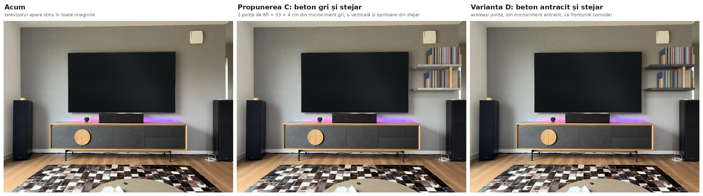

# Polițe viniluri

[Înapoi la prezentarea generală](../README.md)

Două polițe flotante din stejar pentru viniluri, pe peretele cu televizorul din living, în dreapta televizorului, deasupra boxei de podea. Fiecare poliță are 80 × 33 × 4 cm și e prinsă direct în perete, pe patru tije de oțel ascunse în lemn: nu are console, suporți, laterale sau spate, iar prinderea nu se vede. Discurile stau în picioare, între două opritoare; cele de pe polița de sus se termină la nivelul marginii de sus a televizorului. Stejarul are finisajul comodei Veneto. În propunerea A, opritoarele sunt îmbrăcate în stejar, așa că pe perete nu apare nimic negru. În varianta B, opritoarele rămân din oțel negru mat, ca picioarele comodei.

În variantele C și D, polițele sunt din beton decorativ (microciment) și sunt legate de o verticală din stejar masiv. Le găsești [mai jos](#variantele-c-și-d-beton-decorativ-și-stejar), cu randările, planul tehnic și lista lor de materiale. Nu le înlocuiesc pe A și B.

## Conținutul folderului

| Fișier | Conținut |
|---|---|
| [comparatie_acum_vs_propuneri.jpg](comparatie_acum_vs_propuneri.jpg) | Situația actuală, propunerea A (opritoare din stejar) și varianta B (opritoare negre). Televizorul apare stins în toate trei |
| [propunere_A_stejar.jpg](propunere_A_stejar.jpg) | Randarea propunerii A |
| [varianta_B_opritoare_negre.jpg](varianta_B_opritoare_negre.jpg) | Randarea variantei B |
| [plan_tehnic_polite_viniluri.pdf](plan_tehnic_polite_viniluri.pdf) | Planul tehnic A3, scara 1:15: vedere frontală, secțiune, plan, detaliul A (prinderea ascunsă) la 1:3 și detaliul B (opritorul) la 1:5, plus cotele de măsurat ([PNG](plan_tehnic_polite_viniluri.png)) |
| [lista_materiale.md](lista_materiale.md) | Lista de cumpărături, cu prețuri și linkuri |
| [comparatie_acum_vs_propuneri_beton.jpg](comparatie_acum_vs_propuneri_beton.jpg) | Situația actuală, propunerea C (beton gri și stejar) și varianta D (beton antracit și stejar) |
| [propunere_C_beton_gri.jpg](propunere_C_beton_gri.jpg) | Randarea propunerii C |
| [varianta_D_beton_antracit.jpg](varianta_D_beton_antracit.jpg) | Randarea variantei D |
| [plan_tehnic_polite_viniluri_beton.pdf](plan_tehnic_polite_viniluri_beton.pdf) | Planul tehnic A3 al variantelor C și D, scara 1:15, comun pentru amândouă: vedere frontală, secțiune prin verticală, plan, detaliul A (tija), detaliul B (opritorul) și detaliul C (îmbinarea verticalei), plus cotele de măsurat ([PNG](plan_tehnic_polite_viniluri_beton.png)) |
| [lista_materiale_beton.md](lista_materiale_beton.md) | Lista de cumpărături pentru C și D: prețuri verificate și linkuri, plus ce mai e de verificat |

## Ce e acum pe perete

| Ce | Model | Dimensiuni (lățime × înălțime × adâncime) |
|---|---|---|
| Televizor | TCL 98C8L, 98" | 216,6 × 123,6 × 5,4 cm, 57,5 kg, prindere VESA 600 × 500 |
| Comodă TV | Cioata Veneto 242 (cod VE530) | 242 × 67 × 48 cm, pe picioare de 14 cm; stejar masiv, fronturi din microciment antracit |
| Boxă centru | Klipsch RP-504C II | 81,4 × 17,4 × 38,3 cm, pe comodă |
| Boxe de podea | Klipsch RP-8000F II | 27,5 × 109,5 × 46,3 cm, cu picioare; portul de bas e în spate |

Dimensiunile sunt din fișele producătorilor.

## Cote măsurate

Cotele date de tine:
- peretele: 419 cm lățime și 250 cm înălțime.

Cotele estimate din fotografie, cu „~”, trebuie verificate cu ruleta. Fotografia a fost calibrată pe dimensiunile televizorului, comodei și peretelui:
- televizorul: de la ~83 la ~206,6 cm de la pardoseală, cu axul la ~210,7 cm de colțul din stânga, practic la mijlocul peretelui (209,5 cm);
- comoda: de la ~84,8 la ~326,8 cm de colț, la ~8,7 cm de perete;
- boxele de podea: la ~14–43 cm și la ~388–415 cm de colț, la ~8 cm de perete;
- dispozitivul alb din dreapta, sus: de la ~222,7 la ~248,5 cm înălțime, la ~348,5–373,7 cm de colț;
- plinta: ~7,5 cm.

**Înălțimea camerei:** din fotografie iese ~262 cm, nu 250. Cu 250 cm, poza nu se potrivește cu un televizor de 123,6 cm înălțime: eroarea calibrării crește de la 0,6 la 4,6 px. Remăsoară, dacă poți. Proiectul nu depinde de tavan: polițele se poziționează față de televizor.

**Cote de măsurat**, înainte de comandă și de montaj (sunt și pe plan):
1. Înălțimea camerei.
2. Marginea de sus a televizorului, de la pardoseală (~206,6 cm), și marginea lui din dreapta, de la colțul din stânga (~319 cm).
3. Din ce e peretele și cât e de gros: cărămidă plină sau cu goluri, BCA, beton sau gips-carton (pasul 1 din montaj). Găurile pentru tije au 14 cm adâncime.
4. Codul de finisaj al comodei (CS, NO, FE sau SO), de pe comandă sau factură.
5. Dacă trecerea din dreapta are ușă care se deschide spre peretele cu televizorul. Polițele se termină la 10 cm de capătul peretelui.
6. Pe unde trec cablurile prin perete, în zona polițelor, cu un detector. Verifică mai ales sub dispozitivul alb: a doua tijă cade pe verticala lui. Fă asta înainte ca tâmplarul să dea găurile în polițe, ca o tijă să poată fi mutată, dacă e nevoie.

## Cum e gândit

- **Doar linii de stejar.** Polițele n-au laterale, spate, console sau suporți la vedere. Stau pe tije de oțel care intră în perete și în poliță, așa că par să iasă direct din perete. Peretele rămâne liber, iar discurile se văd cu totul.
- **Doar în dreapta televizorului.** Polițele stau între televizor și capătul peretelui, deasupra boxei din dreapta. În stânga, peretele rămâne liber.
- **Subțiri: 4 cm.** E cea mai mică grosime în care tija M12 încape cu destul lemn deasupra și dedesubt: gaura are 13 mm, deci rămân câte 13,5 mm de stejar. Polițele Wally de la Cioata au 6 cm.
- **Discurile stau în picioare.** Fiecare rând are câte un opritor la fiecare capăt, care se mută după cum crește colecția. Opritorul e un L din oțel, cu talpa sub discuri: greutatea discurilor îl ține pe loc.
  - În A, pe fiecare opritor se lipește o placă de stejar de 2 × 12 × 18 cm, ca să nu apară nimic negru pe perete.
  - În B, opritoarele rămân negre.
- **Adâncimea.** Coperta unui disc are 31,4 × 31,4 cm, iar polița are 33 cm adâncime: discul încape întreg și nu iese în față. Discurile stau la 7 mm de perete.
- **Poziția.**
  - Discurile de sus se termină la nivelul marginii de sus a televizorului (~206,6 cm).
  - Între rânduri rămân 8 cm, ca să scoți ușor un disc.
  - Polița de jos e la 18,3 cm deasupra boxei de podea.
  - Polițele încep la 10 cm de marginea televizorului și se termină la 10 cm de capătul peretelui.
  - Discurile stau spre capătul peretelui, iar lângă televizor rămâne loc liber.
- **Boxa rămâne pe loc.** Polițele au 33 cm adâncime, iar boxa 46,3 cm, deci boxa iese în față. Portul de bas din spatele ei rămâne liber.
- **Capacitatea.** Încap ~134 de discuri pe poliță, lăsând ~10 % loc liber, adică ~268 în total. Ticsită, o poliță ține ~186 de discuri.
- **Rezistența.**
  - Plină, o poliță are ~38 kg: 7,6 kg stejarul și ~31 kg discurile.
  - O țin 4 tije M12 din oțel de clasa 4.8, care începe să se îndoaie la 320 MPa.
  - Am luat cazul cel mai rău: polița stă doar în tije, fără să se sprijine pe perete. Chiar și așa, tijele lucrează la ~165 MPa, de ~1,9 ori sub limită.
  - În realitate, muchia de jos a poliței se sprijină și pe perete, așa că tijele lucrează mai puțin.
  - Cu 3 tije, rezerva ar fi fost de numai ~1,45; de aceea sunt 4.
- **Asortat cu comoda.** Stejarul are același finisaj ca rama comodei. Cioata are 4 finisaje: CS Castle Oak, NO Natural Oak, FE Ferro și SO Smoked Oak. În fotografie, comoda seamănă cu Natural Oak. Negrul opritoarelor din varianta B vine de la picioarele comodei, de la televizor și de la boxe.

## Execuția polițelor

Polițe de 80 × 33 × 4 cm din stejar masiv, cu găuri pentru tije, nu există gata făcute, așa că se comandă.

1. **La Cioata, după modelul Wally.** Wally standard are 80 × 23 × 6 cm, în aceleași 4 finisaje ca și comoda, cu prindere ascunsă (sistemul Triade). Cioata face piesele la comandă, cu altă dimensiune și alt finisaj, în 2–8 săptămâni. E singura cale prin care stejarul iese garantat ca la comodă.
   - Cere 2 polițe de 80 × 33 × 4 cm, în finisajul comodei, și spune-le codul de finisaj.
   - Întreabă dacă prinderea lor încape într-o poliță de 4 cm și dacă ține ~40 kg la 33 cm adâncime: Wally standard e dată pentru 39 kg la 23 cm. Dacă nu se poate, cere polițele cu cele 4 găuri din detaliul A și prinde-le pe tije, ca mai jos.
   - Cere-le și cele 4 plăci de stejar de 2 × 12 × 18 cm pentru opritoarele din A.
   - Cioata nu montează pe perete, așa că montajul îl faci după pașii de mai jos.
2. **La un tâmplar**, după planul tehnic:
   - stejar masiv încleiat, 80 × 33 × 4 cm, cu 4 găuri Ø13 × 26 cm în cantul din spate, la mijlocul grosimii, la 8, 29, 51 și 72 cm de capătul din stânga; găurile se dau cu un burghiu lung, pe un ghidaj, ca să iasă drepte și paralele;
   - 4 plăci de stejar de 2 × 12 × 18 cm, pentru opritoarele din A;
   - un șablon: o șipcă de 80 cm cu cele 4 găuri în aceleași poziții, ca să marchezi găurile din perete și să ții tijele paralele cât se întărește ancora;
   - o probă de ulei pe un rest de stejar, pe care o compari cu comoda, la lumina zilei, înainte de finisaj.

Prețurile de referință și materialele sunt în [lista de materiale](lista_materiale.md).

## Montaj pas cu pas

Montajul îl fac comod două persoane, în două reprize: întâi găurile și tijele, iar polițele după ce s-a întărit ancora chimică (câteva ore, cât scrie pe cartuș). Dacă Cioata vine cu prinderea ei, o montezi după instrucțiunile lor, pe cotele de mai jos.

### Cote de montaj

| Ce | Cât |
|---|---|
| Polițele | de la ~329 la ~409 cm de colțul din stânga: încep la 10 cm de marginea din dreapta a televizorului și se termină la 10 cm de capătul peretelui |
| Polița de jos | fața de jos la ~127,8 cm, fața de sus la ~131,8 cm |
| Polița de sus | fața de jos la ~171,2 cm, fața de sus la ~175,2 cm, adică 31,4 cm sub marginea de sus a televizorului |
| Tijele | 4 pe poliță, la 8, 29, 51 și 72 cm de capătul din stânga al poliței (la 18, 39, 61 și 82 cm de marginea televizorului), la mijlocul grosimii: ~129,8 cm (jos) și ~173,2 cm (sus) |
| Găurile din perete | Ø14 mm, adânci de 14 cm; tija intră 13 cm în perete și 25 cm în poliță |
| Opritoarele | câte două pe poliță, la capetele rândului de discuri |

Toate cotele de înălțime se raportează la marginea de sus a televizorului: polița de sus e la 31,4 cm sub ea, iar polița de jos la încă 43,4 cm mai jos (4 + 8 + 31,4). Dacă la pasul 2 televizorul iese la altă înălțime, muți totul cu aceeași diferență.

### Materiale și unelte

Materialele, cu prețuri și linkuri, sunt în [lista_materiale.md](lista_materiale.md):
- 2 polițe 80 × 33 × 4 cm, cu câte 4 găuri în cant, și șablonul pentru găuri;
- 4 opritoare L din oțel negru mat; pentru A, și 4 plăci de stejar de 2 × 12 × 18 cm;
- 4 tije filetate M12 de 1 m: din fiecare ies două bucăți de 38 cm;
- un cartuș de ancoră chimică și un tub de adeziv de montaj transparent.

Unelte:
- bormașină cu percuție, care să poată merge și doar pe rotire;
- burghiu de zidărie Ø14 mm, lung de cel puțin 160 mm;
- nivelă laser sau nivelă de 1–2 m, ruletă, creion;
- detector de cabluri și țevi;
- pistol pentru cartuș și o perie pentru curățat găurile;
- polizor unghiular sau fierăstrău pentru metal, pentru tăiat tijele;
- aspirator, bandă de mascare, o scară și încă o persoană.

### 1. Cu o zi înainte

1. Lasă polițele în cameră 24 de ore, ca lemnul să ia temperatura și umiditatea din casă.
2. Marchează pe perete traseele de cabluri găsite cu detectorul (cota de măsurat 6), de la ~120 la ~185 cm înălțime, între televizor și capătul peretelui. Cablurile merg de obicei pe verticală, de la prize și de la aparate.
3. Verifică din ce e peretele, cu o gaură de probă de Ø6 mm în zona polițelor:
   - praful roșu înseamnă cărămidă;
   - praful cenușiu înseamnă beton;
   - dacă burghiul intră brusc în gol, e cărămidă cu goluri;
   - praful alb și moale înseamnă BCA;
   - o placă subțire cu gol în spate înseamnă gips-carton.

   Ancora chimică ține în cărămidă plină și în beton. În cărămidă cu goluri și în BCA îi trebuie manșoane-sită, iar pe gips-carton polițele nu se prind fără un montator.

### 2. Trasează pe perete

1. Cu nivela laser, prelungește spre dreapta linia marginii de sus a televizorului. Măsoar-o de la pardoseală și notează valoarea, **T** (ar trebui să fie ~206,6 cm).
2. Trasează liniile orizontale, măsurate de la linia T în jos:
   - fața de sus a poliței de sus, la T − 31,4 cm;
   - axul tijelor poliței de sus, la T − 33,4 cm;
   - fața de jos a poliței de sus, la T − 35,4 cm;
   - fața de sus a poliței de jos, la T − 74,8 cm;
   - axul tijelor poliței de jos, la T − 76,8 cm;
   - fața de jos a poliței de jos, la T − 78,8 cm.
3. Trasează verticala la 10 cm de marginea din dreapta a televizorului: acolo e capătul polițelor dinspre televizor. Încă 80 cm mai încolo e capătul exterior. Verifică: polițele ar trebui să se termine la ~10 cm de capătul peretelui.
4. Pe cele două linii de ax, marchează tijele cu șablonul, cu capătul lui pe verticala de la pasul 3: la 8, 29, 51 și 72 cm de ea.

### 3. Prinde tijele în perete

1. Taie tijele M12 în 8 bucăți de 38 cm și pilește capetele.
2. Lipește bandă de mascare pe burghiul de Ø14, la 140 mm de vârf, și dă găurile până la bandă, perpendicular pe perete:
   - în cărămidă plină sau beton, cu percuție;
   - în cărămidă cu goluri, doar pe rotire, ca să nu spargi pereții interiori ai cărămizii.
3. Curăță fiecare gaură de trei ori: suflă praful, perie, apoi suflă din nou. Ancora nu ține în praf.
4. În cărămidă cu goluri sau în BCA, bagă întâi câte un manșon-sită în fiecare gaură.
5. Pune cartușul în pistol și aruncă primele 10 cm de material, până iese de o culoare uniformă. Umple fiecare gaură cam pe două treimi, pornind de la fund.
6. Bagă tijele rotindu-le, până rămân 25 cm afară. Pune șablonul pe cele patru tije ale unei polițe, la 1 cm de perete, ca să rămână paralele, și verifică cu nivela că sunt la aceeași înălțime și perpendiculare pe perete.
7. Lasă ancora să se întărească cât scrie pe cartuș, la temperatura din cameră, apoi scoate șablonul. Nu pune nimic pe tije până atunci.
8. Pune o picătură de adeziv de montaj în fiecare gaură a poliței și glisează polița pe tije, până la perete. Adezivul o împiedică să alunece în față.

### 4. Pune opritoarele și discurile

1. Pentru varianta A, lipește pe fiecare opritor, pe fața dinspre exterior, o placă de stejar de 2 × 12 × 18 cm, cu adeziv de montaj. Lasă-l să se usuce cât scrie pe tub.
2. Pune un opritor la capătul poliței dinspre capătul peretelui, cu talpa pe poliță, spre interior.
3. Așază discurile în picioare, cu cotorul în față, lipite de opritor și la ~7 mm de perete.
4. Pune al doilea opritor imediat după ultimul disc, cu talpa sub ultimele discuri.
5. Lasă ~10 % loc liber, ca discurile să iasă ușor și să nu se îndoaie copertele.
6. Încarcă polițele treptat. După primele discuri, verifică dacă polița se lasă în față. Dacă se lasă, oprește-te și verifică prinderea.

### 5. Verificare finală

- Polițele sunt la nivel, la 10 cm de televizor, iar discurile de sus se termină la nivelul marginii lui de sus.
- Nu se vede nicio prindere, iar polițele nu se mișcă atunci când le apeși ferm în jos, la capătul din față.
- Discurile stau drept și ies ușor.
- Boxa de podea din dreapta a rămas cu portul din spate liber, la ~8 cm de perete.
- Dacă trecerea din dreapta are ușă, ușa nu atinge polițele.

## Întreținere

- Praful se ia cu o cârpă moale și uscată sau cu peria aspiratorului.
- Stejarul se îngrijește la fel ca comoda: cu produsul de întreținere recomandat de Cioata, iar la polițele făcute de tâmplar, cu uleiul folosit la finisaj, o dată la 1–2 ani. La fel și plăcile de stejar de pe opritoare.
- Opritoarele negre din varianta B se șterg cu o cârpă ușor umedă.
- Discurile stau în picioare, fără să fie înghesuite, departe de căldură și de soare direct.

## Variantele C și D: beton decorativ și stejar

A doua propunere pentru aceleași polițe, în plus față de A și B, pe care nu le înlocuiește: aceleași două polițe flotante de 80 × 33 × 4 cm, în dreapta televizorului, prinse ascuns în perete pe câte 4 tije, dar din beton decorativ (microciment) și legate printr-o verticală din stejar masiv. Materialele sunt cele ale comodei Cioata Veneto: stejarul face structura, iar betonul formează planurile. În propunerea C betonul e gri natural, iar în varianta D e antracit, ca fronturile comodei. C și D au planul lor tehnic, [lista lor de materiale](lista_materiale_beton.md) și montajul lor, descrise mai jos.

### Cum sunt gândite C și D

Principiile de design:
- **Două materiale și atât:** stejarul, cald, și betonul, rece și mat.
- **Betonul la planurile orizontale, lemnul la elementul vertical,** ca la comodă.
- **Aceeași grosime, 4 cm,** la polițe și la verticală.
- **Un rost de umbră între piese.**
- **Fără feronerie la vedere:** tijele sunt ascunse în polițe, cepurile în îmbinare, iar oțelul opritoarelor e acoperit de stejar și de discuri.

De ce așa:
- **Ca la comodă.** Comoda Veneto are rama din stejar masiv și fronturile din microciment antracit. Polițele urmează aceeași logică: stejarul e structura caldă, betonul formează planurile. Pe perete apar aceleași două materiale ca pe comoda de dedesubt.
- **Microciment, nu beton turnat.** Polițele au un miez din 2 plăci de placaj de mesteacăn de 18 mm, lipite, acoperit cu ~2 mm de microciment. Arată ca betonul, dar o poliță are ~8,5 kg.
  - O placă din beton turnat GFRC (beton armat cu fibră de sticlă) de 80 × 33 × 4 cm ar avea ~22 kg (la ~2,1 g/cm³), adică de ~2,6 ori mai mult: ~14 kg în plus pe fiecare poliță.
  - Tijele și ancorele ar avea mai puțină rezervă, iar polița s-ar putea fisura.
  - Microcimentul e chiar materialul fronturilor comodei.
- **O singură verticală, așezată asimetric.**
  - Ansamblul rămâne deschis. O ramă cu verticale la ambele capete ar face din polițe o „cutie”, iar corpurile tip cutie le-ai respins încă de la variantele A și B.
  - La vedere rămân cât mai puține elemente.
  - Fața din stânga a verticalei e în dreptul marginii din stânga a boxei de podea de dedesubt, așa că linia boxei urcă mai departe, până sub polița de sus.
- **Verticala nu duce polița de sus.** E lipită din atelier doar de polița de jos și se oprește la 3 mm sub polița de sus: rostul de umbră. Fiecare poliță stă pe tijele ei.
- **Polițele, ca la A și B.** Aceleași locuri, aceeași adâncime, aceeași grosime și aceeași prindere ascunsă: fiecare poliță stă pe 4 tije M12 care intră în perete și în poliță, fără console sau suporți la vedere. Coperta unui disc are 31,4 × 31,4 cm, iar polița are 33 cm adâncime: discul încape întreg, la ~7 mm de perete, și nu iese în față.
- **Discurile stau în picioare.**
  - Jos, rândul mare se sprijină în verticală, iar lângă televizor rămâne loc liber. Golul mic din dreapta verticalei, spre capătul peretelui, e plin.
  - Opritoarele stau doar la capetele libere ale rândurilor: câte 2 pe poliță, 4 în total. Capătul de rând sprijinit în verticală nu are opritor.
  - Opritorul e ca în propunerea A: un L din oțel, cu talpa sub discuri, și o placă de stejar de 2 × 12 × 18 cm lipită pe fața exterioară. Greutatea discurilor îl ține pe loc, iar el se mută după cum crește colecția.
  - Sub talpa opritorului se lipește o folie transparentă autoadezivă, ca oțelul să nu zgârie lacul.
- **Poziția.**
  - Discurile de sus se termină la nivelul marginii de sus a televizorului (~206,6 cm). Între rânduri rămân 8 cm, ca să scoți ușor un disc.
  - Polițele încep la 10 cm de marginea televizorului și se termină la 10 cm de capătul peretelui.
  - Polița de jos e la 18,3 cm deasupra boxei de podea, iar discurile de sus se termină la 16,1 cm sub dispozitivul alb.
- **Boxa rămâne pe loc.** Polițele au 33 cm adâncime, iar boxa 46,3 cm, deci boxa iese în față. Portul de bas din spatele ei rămâne liber.
- **Capacitatea.** Așezate comod, cu ~10 % loc liber, încap ~126 de discuri jos și ~134 sus, adică ~260. Ticsite: ~176 jos și ~186 sus, adică ~362.
- **Greutatea.** Goală, o poliță are ~8,5 kg, iar verticala ~3,7 kg. La montaj ridici polița de jos cu verticala (~12,2 kg) și polița de sus (~8,5 kg). Plină, polița de jos are ~41,2 kg (8,5 kg polița, ~29 kg discurile și 3,7 kg verticala), iar cea de sus ~39,3 kg. Cu discurile ticsite: ~52,7 kg și ~51,3 kg.
- **Rezistența.**
  - Cazul cel mai rău: polița de jos, cu discurile ticsite, stă doar în tije, fără să se sprijine pe perete. Tijele lucrează atunci la ~227 MPa.
  - Tijele sunt de clasa 8.8, care începe să se îndoaie la 640 MPa: rezerva e de ~2,8. Cu discurile așezate comod, efortul scade la ~178 MPa, iar rezerva crește la ~3,6.
  - Tija zincată obișnuită, de clasa 4.8, folosită la A și B, începe să se îndoaie la 320 MPa. Aici, cu discurile ticsite, ar avea o rezervă de numai ~1,4, așa că nu se folosește.
  - În realitate, muchia de jos a poliței se sprijină pe perete. Atunci tijele se îndoaie mai puțin, dar trag de ancoră: când polița plină se sprijină pe perete, fiecare tijă duce la smulgere ~1,07 kN, cam cât greutatea a 109 kg (~0,83 kN cu discurile așezate comod).
  - Ancora trebuie să țină asta în peretele tău. Verifică în fișa tehnică a ancorei sarcina admisă pentru tipul tău de perete și fă proba de încărcare de la pasul 7 din montajul pentru C și D.
- **Opțiune, doar în text: mai multe verticale.** Dacă vrei mai multe verticale, se poate adăuga una pe polița de jos, în stânga. Ca prima, stă între două tije, ca cepurile ei să nu întâlnească canalele tijelor. În sursele variantelor C și D, în `design.py`, se adaugă poziția ei în `VERTS` și se împart rândurile de discuri din `ROWS`. Rândul mare de jos ar avea cu ~4 cm mai puțin, adică vreo 7 discuri: ~119 de discuri pe polița de jos, în loc de ~126, așezate comod.

### Gri sau antracit

- **Propunerea C: beton gri natural și stejar** ([randarea](propunere_C_beton_gri.jpg)). Polițele sunt din microciment gri natural, deschis și ușor cald. Pe peretele deschis la culoare rămân ușoare, iar verticala și opritoarele din stejar se văd bine.
- **Varianta D: beton antracit și stejar** ([randarea](varianta_D_beton_antracit.jpg)). Polițele sunt din microciment antracit, ca fronturile comodei. E mai închisă la culoare: o alegi doar dacă îți place mai mult.
- Planul, cotele, stejarul și montajul sunt aceleași. Se schimbă doar culoarea microcimentului, pe care o alegi pe mostră (vezi [execuția](#execuția-cerută-atelierului)).

### Cote pentru C și D

Ce e acum pe perete și cotele luate din fotografie sunt cele de mai sus, de la [Ce e acum pe perete](#ce-e-acum-pe-perete) și [Cote măsurate](#cote-măsurate). În plus, C și D se raportează la boxa de podea din dreapta: fața din stânga a verticalei vine în dreptul marginii din stânga a boxei, la ~387,6 cm de colțul din stânga. Nici aici proiectul nu depinde de tavan: polițele se poziționează față de televizor, iar verticala față de boxă.

#### Cote de măsurat pentru C și D, înainte de comandă

Sunt și pe [planul lui C și D](plan_tehnic_polite_viniluri_beton.pdf). Canalele tijelor se frezează în miez înainte de lipire, așa că după comandă o tijă nu se mai poate muta.
1. **Peretele:** din ce e și cât e de gros: cărămidă plină sau cu goluri, BCA, beton sau gips-carton. Găurile pentru tije au 14 cm adâncime. Proba e la pasul 1 din montajul pentru C și D.
2. **Înălțimea camerei.**
3. **Marginile televizorului:** cea de sus, de la pardoseală (~206,6 cm), și cea din dreapta, de la colțul din stânga (~319 cm).
4. **Marginea din stânga a boxei de podea din dreapta,** de la colț (~387,6 cm): în dreptul ei vine fața din stânga a verticalei.
5. **Cablurile** din perete, în zona polițelor, cu un detector: de la ~120 la ~185 cm înălțime, între televizor și capătul peretelui. Verifică mai ales sub dispozitivul alb: a doua tijă (la ~358 cm de colț) cade pe verticala lui.
6. **Ușa din dreapta:** dacă trecerea din dreapta are ușă care se deschide spre peretele cu televizorul. Polițele se termină la 10 cm de capătul peretelui.
7. **Finisajul comodei:** codul de finisaj al stejarului (CS, NO, FE sau SO), de pe comandă sau factură, pentru verticală și pentru plăcile opritoarelor. În fotografie, comoda seamănă cu NO (Natural Oak). Tonul microcimentului îl compari pe mostră, cu fronturile comodei.

### Execuția cerută atelierului

Polițe de 80 × 33 × 4 cm din microciment, cu canale pentru tije și cu o verticală din stejar, nu există gata făcute, așa că se comandă. Două căi, cu prețul la cerere:
- **Un atelier de mobilier care lucrează cu microciment,** după [planul tehnic al lui C și D](plan_tehnic_polite_viniluri_beton.pdf). Verticala și plăcile de stejar le poate face același atelier sau un tâmplar.
- **Cioata, de întrebat.** Pe site scrie că fiecare piesă se personalizează, ca dimensiune și finisaj, dar nu e sigur că face și piese din microciment la comandă. Întreabă-i dacă pot face polițele în microcimentul fronturilor comodei, iar verticala și plăcile opritoarelor în stejarul ramei. Cioata nu montează pe perete, așa că montajul îl faci după pașii de mai jos.

Ce ceri, oricine le face:
1. **Polițele:** 2 bucăți de 80 × 33 × 4 cm. Miezul e din 2 plăci de placaj de mesteacăn de 18 mm, lipite, iar deasupra, dedesubt, în față și la capete are ~2 mm de microciment.
2. **Canalele tijelor:** 4 pe poliță, Ø14 mm × 26 cm, în cantul din spate, la mijlocul grosimii, la 8, 29, 51 și 72 cm de capătul din stânga. Se fac din două semicanale frezate în cele două plăci ale miezului înainte de lipire, ca să iasă drepte și paralele.
3. **Muchiile care se văd:** rotunjite R3, ca microcimentul să nu se ciobească.
4. **Sistemul de microciment pentru mobilier:** grund, plasă din fibră de sticlă care trece peste muchii, straturile de bază și de finisaj, apoi lac poliuretanic bicomponent mat. Spatele și canalele se sigilează, ca miezul să nu ia umezeală.
5. **Locașul verticalei:** pe polița de jos, microcimentul se oprește pe conturul verticalei, la 58,6–62,6 cm de capătul din stânga. Rămâne un locaș de 2 mm, cu placajul curat.
6. **Verticala:** stejar masiv încleiat, 4 cm grosime, 33 cm adâncime și 39,3 cm înălțime, cu fibra pe verticală (39,1 cm se văd, iar 2 mm intră în locaș). Finisajul e cel al ramei comodei.
7. **Îmbinarea (detaliul C din plan):** 3 cepuri din fag Ø8 × 40 mm, la 6, 16,5 și 27 cm de perete, care intră 1,5 cm în poliță și 2,5 cm în verticală.
   - Doar cepul din mijloc se lipește. Pentru celelalte două, găurile din verticală sunt ovale, în adâncime, pentru că stejarul lucrează, iar placajul nu.
   - Verticala se lipește pe placajul curat din locaș, după ce s-a uscat lacul, nu peste lac. Adezivul se pune doar în jurul cepului din mijloc, din același motiv.
   - Rostul de 3 mm de sub polița de sus se verifică la montaj: verticala nu atinge polița de sus.
8. **O mostră** de microciment cu o muchie finisată, în tonul ales, pe care o compari cu comoda, la lumina zilei, înainte de execuție. În varianta D, o compari cu fronturile.
9. **Șablonul:** o bucată de 80 × 20 × 4 cm din același miez, cu aceleași 4 canale, în aceleași poziții. Axul canalelor e la 2 cm de fața de jos, ca la poliță. Cu el marchezi găurile din perete și ții tijele paralele până se întărește ancora.
10. **Plăcile opritoarelor:** 4 plăci de stejar de 2 × 12 × 18 cm, în finisajul verticalei.

Prețurile de referință și materialele sunt în [lista de materiale pentru C și D](lista_materiale_beton.md).

### Montaj pas cu pas pentru C și D

Montajul îl fac comod două persoane, în mai multe reprize: întâi tijele poliței de jos, apoi polița de jos cu verticala, apoi tijele și polița de sus. Între reprize se așteaptă să se întărească ancora chimică și adezivul, cât scrie pe ambalaj. La final vin proba de încărcare, de 24 de ore, și abia apoi discurile.

#### Cote de montaj pentru C și D

| Ce | Cât |
|---|---|
| Polițele | de la ~329 la ~409 cm de colțul din stânga: încep la 10 cm de marginea din dreapta a televizorului și se termină la 10 cm de capătul peretelui |
| Polița de jos | fața de jos la ~127,8 cm, fața de sus la ~131,8 cm |
| Polița de sus | fața de jos la ~171,2 cm, fața de sus la ~175,2 cm, adică 31,4 cm sub marginea de sus a televizorului |
| Verticala | pe polița de jos, cu fața din stânga la 58,6 cm de capătul din stânga al poliței (~387,6 cm de colț, în dreptul marginii din stânga a boxei din dreapta); se vede de la ~131,8 la ~170,9 cm, cu un rost de 3 mm sub polița de sus |
| Tijele | M12, clasa 8.8, câte 38 cm; 4 pe poliță, la 8, 29, 51 și 72 cm de capătul din stânga al poliței (la 18, 39, 61 și 82 cm de marginea televizorului), la mijlocul grosimii: ~129,8 cm (jos) și ~173,2 cm (sus) |
| Găurile din perete | Ø14 mm, adânci de 14 cm, în zidărie plină; tija intră 13 cm în perete și 25 cm în poliță |
| Opritoarele | 4, doar la capetele libere ale rândurilor: jos, unul la capătul din stânga al rândului mare și unul la capătul poliței, după golul mic; sus, câte unul la fiecare capăt al rândului |

Toate cotele de înălțime se raportează la marginea de sus a televizorului, **T**: polița de sus e la 31,4 cm sub ea, iar polița de jos la încă 43,4 cm mai jos (4 + 8 + 31,4). Dacă la pasul 2 televizorul iese la altă înălțime, muți totul cu aceeași diferență.

#### Materiale și unelte pentru C și D

Materialele, cu prețuri și linkuri, sunt în [lista_materiale_beton.md](lista_materiale_beton.md):
- polița de jos, cu verticala lipită din atelier (~12,2 kg), polița de sus (~8,5 kg) și șablonul de 80 × 20 × 4 cm;
- 4 tije filetate M12 de clasa 8.8, de 1 m: din fiecare ies două bucăți de 38 cm. Nu folosi tija zincată obișnuită, de clasa 4.8;
- un cartuș de ancoră chimică și, numai pentru cărămidă cu goluri sau BCA, 8 manșoane-sită;
- adeziv epoxidic bicomponent, pentru tijele din polițe;
- 4 opritoare L din oțel, 4 plăci de stejar de 2 × 12 × 18 cm, adeziv Fix All Crystal și folie transparentă autoadezivă pentru tălpile opritoarelor;
- pentru proba de încărcare: 55 kg pe fiecare poliță (de exemplu, 11 bidoane de 5 l cu apă) și scânduri, cu o pânză moale dedesubt.

Unelte:
- bormașină cu percuție, care să poată merge și doar pe rotire;
- burghiu de zidărie Ø14 mm, lung de cel puțin 160 mm, și unul de Ø6 mm, pentru gaura de probă;
- nivelă laser sau nivelă de 1–2 m, ruletă, creion;
- detector de cabluri și țevi;
- pistol pentru cartuș, o perie pentru găuri și o pompă de suflat;
- polizor unghiular sau fierăstrău pentru metal și o pilă, pentru tăiat tijele;
- pentru șablon: două proptele reglabile sau un suport la înălțimea poliței de jos, distanțiere de 3 mm (de exemplu, cele pentru faianță), un calup de lemn de ~39 cm și câteva pene;
- mănuși, bandă de mascare, cârpe, aspirator, o scară și încă o persoană.

#### 1. Verificările dinainte

1. Lasă polițele în cameră 24 de ore, ca lemnul și placajul să ia temperatura și umiditatea din casă.
2. Verifică piesele: verticala e lipită drept, în unghi drept cu polița, iar o tijă de 38 cm intră liber, până la capăt, în fiecare canal și în șablon.
3. Remăsoară cotele de mai sus: linia T, marginea din dreapta a televizorului și marginea din stânga a boxei din dreapta.
4. Marchează pe perete traseele de cabluri găsite cu detectorul (cota de măsurat 5 pentru C și D). Nicio gaură nu se dă pe un traseu.
5. Verifică din ce e peretele (cota de măsurat 1 pentru C și D), cu o gaură de probă de Ø6 mm în zona polițelor:
   - praful roșu înseamnă cărămidă;
   - praful cenușiu înseamnă beton;
   - dacă burghiul intră brusc în gol, e cărămidă cu goluri;
   - praful alb și moale înseamnă BCA;
   - o placă subțire cu gol în spate înseamnă gips-carton.

   Ancora chimică ține în cărămidă plină și în beton. În cărămidă cu goluri și în BCA îi trebuie manșoane-sită. În fișa tehnică a ancorei verifici că, în peretele tău, ține ~1,07 kN pe tijă. Pe gips-carton, polițele nu se prind fără un montator.

#### 2. Trasează și găurește pentru polița de jos

1. Cu nivela laser, prelungește spre dreapta linia marginii de sus a televizorului. Măsoar-o de la pardoseală și notează valoarea, **T** (ar trebui să fie ~206,6 cm).
2. Trasează liniile orizontale, măsurate de la linia T în jos:
   - fața de sus a poliței de sus, la T − 31,4 cm;
   - axul tijelor poliței de sus, la T − 33,4 cm;
   - fața de jos a poliței de sus, la T − 35,4 cm;
   - fața de sus a poliței de jos, la T − 74,8 cm;
   - axul tijelor poliței de jos, la T − 76,8 cm;
   - fața de jos a poliței de jos, la T − 78,8 cm.
3. Trasează verticala la 10 cm de marginea din dreapta a televizorului: acolo e capătul polițelor dinspre televizor. Încă 80 cm mai încolo e capătul exterior. Verifică:
   - polițele ar trebui să se termine la ~10 cm de capătul peretelui;
   - fața din stânga a verticalei vine la 58,6 cm de linia ta, în dreptul marginii din stânga a boxei din dreapta. Dacă diferă cu 1–2 cm, muți boxa, nu polițele.
4. Ține șablonul la nivel, lipit de perete, cu fața de jos pe linia T − 78,8 și cu capătul din stânga pe verticala de la pasul 3. Marchează centrele celor 4 găuri prin canale, cu burghiul de Ø14 trecut prin canal și rotit cu mâna, fără bormașină. Șablonul e ghidul pentru poziții: nu găuri prin el, ca să nu-i lărgești canalele.
5. Taie tijele M12 în 8 bucăți de 38 cm și pilește capetele. Pe fiecare tijă, lipește o bandă de mascare la 13 cm de un capăt: până acolo intră în perete.
6. Lipește bandă de mascare pe burghiul de Ø14, la 140 mm de vârf. Dă găurile până la bandă, perpendicular pe perete:
   - în cărămidă plină sau în beton, cu percuție;
   - în cărămidă cu goluri sau în BCA, cum cere manșonul-sită (diametrul și adâncimea sunt pe ambalaj), doar pe rotire, ca să nu spargi pereții interiori ai cărămizii.

#### 3. Prinde tijele poliței de jos

1. Curăță fiecare gaură de trei ori: suflă praful, perie, apoi suflă din nou. Ancora nu ține în praf.
2. În cărămidă cu goluri sau în BCA, bagă întâi câte un manșon-sită în fiecare gaură.
3. Pune cartușul în pistol și aruncă primele 10 cm de material, până iese de o culoare uniformă. Umple fiecare gaură cam pe două treimi, pornind de la fund.
4. Ține șablonul la ~1 cm de perete, la nivel, cu canalele în dreptul găurilor. Trece cele 4 tije prin canalele lui și bagă-le în găuri, rotindu-le, până la banda de la 13 cm: 25 cm rămân afară.
5. Sprijină șablonul pe proptele, la nivel, și verifică cu nivela că tijele sunt la aceeași înălțime și perpendiculare pe perete. Șterge ancora ieșită din găuri.
6. Șablonul rămâne pe tije, la nivel, până se întărește ancora, cât scrie pe cartuș pentru temperatura din cameră. Apoi îl scoți. Nu pune nimic pe tije până atunci.

#### 4. Pune polița de jos, cu verticala

1. Lipește bandă de mascare pe perete, în jurul tijelor, și pe muchia din spate a poliței, ca adezivul să nu păteze microcimentul.
2. Probează polița fără adeziv: împinge-o pe tije până la perete și verifică dacă e la nivel. Apoi scoate-o.
3. Amestecă adezivul epoxidic, cu mănuși, și întinde un strat subțire doar pe ultimii ~8 cm ai tijelor, lângă perete.
4. Împinge polița, cu verticala, pe tije, până la perete. Șterge imediat adezivul ieșit și scoate banda de mascare.
5. Lasă adezivul să se întărească, cât scrie pe ambalaj, înainte să sprijini ceva pe verticală.

#### 5. Găurește și prinde tijele poliței de sus

1. Pune o pânză pe polița de jos, ca s-o ferești de praf și de zgârieturi.
2. Așază distanțiere de 3 mm pe capul verticalei și pune șablonul pe ele, lipit de perete, cu capătul din stânga în dreptul capătului poliței de jos. În stânga, sprijină-l pe calupul de ~39 cm, pus pe polița de jos, și adu-l la nivel cu pene.
3. Verifică: fața de jos a șablonului ar trebui să iasă pe linia T − 35,4. Dacă diferă cu câțiva milimetri, te iei după verticală: rostul de 3 mm se vede, diferența față de televizor nu.
4. Trasează prin canale centrele găurilor, ca la pasul 2, apoi ia șablonul jos.
5. Găurește la fel ca la pasul 2, cu aspiratorul ținut sub gaură.
6. Pune ancora și tijele la fel ca la pasul 3: tijele trec prin șablon, iar șablonul stă pe verticală, peste distanțiere, și pe calup, la ~1 cm de perete și la nivel, până se întărește ancora.

#### 6. Pune polița de sus

1. Pune polița de sus la fel ca pe cea de jos (pasul 4): întâi o probă fără adeziv, apoi un strat subțire de adeziv epoxidic doar pe ultimii ~8 cm ai tijelor, lângă perete.
2. Verifică rostul de 3 mm dintre verticală și polița de sus: un distanțier de 3 mm trebuie să treacă liber pe toată adâncimea. Verticala nu are voie să atingă polița de sus.
3. Lasă adezivul să se întărească, cât scrie pe ambalaj.

#### 7. Proba de încărcare

1. Pune pe fiecare poliță o pânză moale, iar peste ea o scândură, ca greutatea să se împartă și lacul să nu se zgârie. Pe polița de jos, scândura e din două bucăți, de o parte și de alta a verticalei.
2. Verifică polițele cu nivela și notează cum stau: la nivel, lipite de perete.
3. Încarcă 55 kg pe fiecare poliță, întinse pe toată lungimea: mai mult decât cântăresc discurile ticsite (~40,5 kg jos și ~42,8 kg sus). Pe polița de jos, pune ~42 kg în stânga verticalei și ~13 kg în dreapta.
4. Lasă greutatea 24 de ore, apoi verifică din nou cu nivela. Polițele trebuie să fie tot la nivel și lipite de perete, iar rostul de 3 mm trebuie să fie tot liber.
5. Dacă o poliță s-a lăsat în față sau a apărut o fisură în perete lângă ea, descarcă polița și cheamă un montator înainte să pui discurile.

#### 8. Pune opritoarele și discurile

1. Lipește pe fiecare opritor, pe fața exterioară, o placă de stejar de 2 × 12 × 18 cm, cu Fix All Crystal. Lasă-l să se usuce cât scrie pe tub.
2. Lipește sub talpa fiecărui opritor folia transparentă autoadezivă, ca oțelul să nu zgârie lacul.
3. Pe polița de jos, așază discurile în picioare, cu cotorul în față și la ~7 mm de perete:
   - rândul mare pornește din verticală spre stânga, iar după ultimul disc pui un opritor, cu talpa sub ultimele discuri;
   - golul mic din dreapta verticalei îl umpli, cu un opritor la capătul poliței.
4. Pe polița de sus, pune un opritor la capătul dinspre capătul peretelui, așază discurile și pune al doilea opritor imediat după ultimul disc.
5. Lasă ~10 % loc liber, ca discurile să iasă ușor și să nu se îndoaie copertele.

#### 9. Verificare finală

- Polițele sunt la nivel, la 10 cm de televizor, iar discurile de sus se termină la nivelul marginii lui de sus.
- Verticala e în dreptul marginii din stânga a boxei din dreapta, iar rostul de 3 mm de sub polița de sus e liber.
- Nu se vede nicio prindere, iar polițele nu se mișcă atunci când le apeși ferm în jos, la capătul din față.
- Discurile stau drept și ies ușor.
- Boxa de podea din dreapta a rămas cu portul din spate liber, la ~8 cm de perete.
- Dacă trecerea din dreapta are ușă, ușa nu atinge polițele.

### Întreținerea variantelor C și D

- Praful se ia cu o cârpă moale și uscată sau cu peria aspiratorului.
- Microcimentul se curăță cu o cârpă umedă și cu detergent neutru, fără abrazive: fără bureți abrazivi, praf de curățat sau solvenți. Lacul se reîmprospătează cum cere producătorul sistemului de microciment.
- Stejarul verticalei și al plăcilor de pe opritoare se reunge cu ulei, la fel ca comoda: cu produsul de întreținere recomandat de Cioata sau cu uleiul folosit la finisaj, o dată la 1–2 ani. Lipește bandă de mascare pe microciment în jurul verticalei, ca uleiul să nu-l păteze.
- Folia de sub opritoare se schimbă dacă se uzează.
- Discurile stau în picioare, fără să fie înghesuite, departe de căldură și de soare direct.
