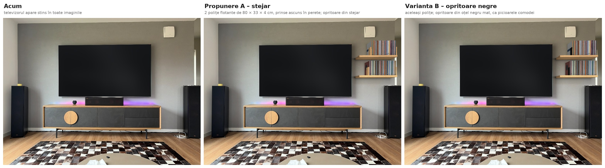

# Polițe viniluri

[Înapoi la prezentarea generală](../README.md)

Două polițe flotante din stejar pentru viniluri, pe peretele cu televizorul din living, în dreapta televizorului, deasupra boxei de podea. Fiecare poliță are 80 × 33 × 4 cm și e prinsă direct în perete, pe patru tije de oțel ascunse în lemn: nu are console, suporți, laterale sau spate, iar prinderea nu se vede. Discurile stau în picioare, între două opritoare; cele de pe polița de sus se termină la nivelul marginii de sus a televizorului. Stejarul are finisajul comodei Veneto. În propunerea A, opritoarele sunt îmbrăcate în stejar, așa că pe perete nu apare nimic negru. În varianta B, opritoarele rămân din oțel negru mat, ca picioarele comodei.

## Conținutul folderului

| Fișier | Conținut |
|---|---|
| [comparatie_acum_vs_propuneri.jpg](comparatie_acum_vs_propuneri.jpg) | Situația actuală, propunerea A (opritoare din stejar) și varianta B (opritoare negre). Televizorul apare stins în toate trei |
| [propunere_A_stejar.jpg](propunere_A_stejar.jpg) | Randarea propunerii A |
| [varianta_B_opritoare_negre.jpg](varianta_B_opritoare_negre.jpg) | Randarea variantei B |
| [plan_tehnic_polite_viniluri.pdf](plan_tehnic_polite_viniluri.pdf) | Planul tehnic A3, scara 1:15: vedere frontală, secțiune, plan, detaliul A (prinderea ascunsă) la 1:3 și detaliul B (opritorul) la 1:5, plus cotele de măsurat ([PNG](plan_tehnic_polite_viniluri.png)) |
| [lista_materiale.md](lista_materiale.md) | Lista de cumpărături, cu prețuri și linkuri |

## Ce e acum pe perete

| Ce | Model | Dimensiuni (lățime × înălțime × adâncime) |
|---|---|---|
| Televizor | TCL 98C8L, 98" | 216,6 × 123,6 × 5,4 cm, 57,5 kg, prindere VESA 600 × 500 |
| Comodă TV | Cioata Veneto 242 (cod VE530) | 242 × 67 × 48 cm, pe picioare de 14 cm; stejar masiv, fronturi din microciment antracit |
| Boxă centru | Klipsch RP-504C II | 81,4 × 17,4 × 38,3 cm, pe comodă |
| Boxe de podea | Klipsch RP-8000F II | 27,5 × 109,5 × 46,3 cm, cu picioare; portul de bas e în spate |

Dimensiunile sunt din fișele producătorilor.

## Cote măsurate

Cotele date de tine:
- peretele: 419 cm lățime și 250 cm înălțime.

Cotele estimate din fotografie, cu „~”, trebuie verificate cu ruleta. Fotografia a fost calibrată pe dimensiunile televizorului, comodei și peretelui:
- televizorul: de la ~83 la ~206,6 cm de la pardoseală, cu axul la ~210,7 cm de colțul din stânga, practic la mijlocul peretelui (209,5 cm);
- comoda: de la ~84,8 la ~326,8 cm de colț, la ~8,7 cm de perete;
- boxele de podea: la ~14–43 cm și la ~388–415 cm de colț, la ~8 cm de perete;
- dispozitivul alb din dreapta, sus: de la ~222,7 la ~248,5 cm înălțime, la ~348,5–373,7 cm de colț;
- plinta: ~7,5 cm.

**Înălțimea camerei:** din fotografie iese ~262 cm, nu 250. Cu 250 cm, poza nu se potrivește cu un televizor de 123,6 cm înălțime: eroarea calibrării crește de la 0,6 la 4,6 px. Remăsoară, dacă poți. Proiectul nu depinde de tavan: polițele se poziționează față de televizor.

**Cote de măsurat**, înainte de comandă și de montaj (sunt și pe plan):
1. Înălțimea camerei.
2. Marginea de sus a televizorului, de la pardoseală (~206,6 cm), și marginea lui din dreapta, de la colțul din stânga (~319 cm).
3. Din ce e peretele și cât e de gros: cărămidă plină sau cu goluri, BCA, beton sau gips-carton (pasul 1 din montaj). Găurile pentru tije au 14 cm adâncime.
4. Codul de finisaj al comodei (CS, NO, FE sau SO), de pe comandă sau factură.
5. Dacă trecerea din dreapta are ușă care se deschide spre peretele cu televizorul. Polițele se termină la 10 cm de capătul peretelui.
6. Pe unde trec cablurile prin perete, în zona polițelor, cu un detector. Verifică mai ales sub dispozitivul alb: a doua tijă cade pe verticala lui. Fă asta înainte ca tâmplarul să dea găurile în polițe, ca o tijă să poată fi mutată, dacă e nevoie.

## Cum e gândit

- **Doar linii de stejar.** Polițele n-au laterale, spate, console sau suporți la vedere. Stau pe tije de oțel care intră în perete și în poliță, așa că par să iasă direct din perete. Peretele rămâne liber, iar discurile se văd cu totul.
- **Doar în dreapta televizorului.** Polițele stau între televizor și capătul peretelui, deasupra boxei din dreapta. În stânga, peretele rămâne liber.
- **Subțiri: 4 cm.** E cea mai mică grosime în care tija M12 încape cu destul lemn deasupra și dedesubt: gaura are 13 mm, deci rămân câte 13,5 mm de stejar. Polițele Wally de la Cioata au 6 cm.
- **Discurile stau în picioare.** Fiecare rând are câte un opritor la fiecare capăt, care se mută după cum crește colecția. Opritorul e un L din oțel, cu talpa sub discuri: greutatea discurilor îl ține pe loc.
  - În A, pe fiecare opritor se lipește o placă de stejar de 2 × 12 × 18 cm, ca să nu apară nimic negru pe perete.
  - În B, opritoarele rămân negre.
- **Adâncimea.** Coperta unui disc are 31,4 × 31,4 cm, iar polița are 33 cm adâncime: discul încape întreg și nu iese în față. Discurile stau la 7 mm de perete.
- **Poziția.**
  - Discurile de sus se termină la nivelul marginii de sus a televizorului (~206,6 cm).
  - Între rânduri rămân 8 cm, ca să scoți ușor un disc.
  - Polița de jos e la 18,3 cm deasupra boxei de podea.
  - Polițele încep la 10 cm de marginea televizorului și se termină la 10 cm de capătul peretelui.
  - Discurile stau spre capătul peretelui, iar lângă televizor rămâne loc liber.
- **Boxa rămâne pe loc.** Polițele au 33 cm adâncime, iar boxa 46,3 cm, deci boxa iese în față. Portul de bas din spatele ei rămâne liber.
- **Capacitatea.** Încap ~134 de discuri pe poliță, lăsând ~10 % loc liber, adică ~268 în total. Ticsită, o poliță ține ~186 de discuri.
- **Rezistența.**
  - Plină, o poliță are ~38 kg: 7,6 kg stejarul și ~31 kg discurile.
  - O țin 4 tije M12 din oțel de clasa 4.8, care începe să se îndoaie la 320 MPa.
  - Am luat cazul cel mai rău: polița stă doar în tije, fără să se sprijine pe perete. Chiar și așa, tijele lucrează la ~165 MPa, de ~1,9 ori sub limită.
  - În realitate, muchia de jos a poliței se sprijină și pe perete, așa că tijele lucrează mai puțin.
  - Cu 3 tije, rezerva ar fi fost de numai ~1,45; de aceea sunt 4.
- **Asortat cu comoda.** Stejarul are același finisaj ca rama comodei. Cioata are 4 finisaje: CS Castle Oak, NO Natural Oak, FE Ferro și SO Smoked Oak. În fotografie, comoda seamănă cu Natural Oak. Negrul opritoarelor din varianta B vine de la picioarele comodei, de la televizor și de la boxe.

## Execuția polițelor

Polițe de 80 × 33 × 4 cm din stejar masiv, cu găuri pentru tije, nu există gata făcute, așa că se comandă.

1. **La Cioata, după modelul Wally.** Wally standard are 80 × 23 × 6 cm, în aceleași 4 finisaje ca și comoda, cu prindere ascunsă (sistemul Triade). Cioata face piesele la comandă, cu altă dimensiune și alt finisaj, în 2–8 săptămâni. E singura cale prin care stejarul iese garantat ca la comodă.
   - Cere 2 polițe de 80 × 33 × 4 cm, în finisajul comodei, și spune-le codul de finisaj.
   - Întreabă dacă prinderea lor încape într-o poliță de 4 cm și dacă ține ~40 kg la 33 cm adâncime: Wally standard e dată pentru 39 kg la 23 cm. Dacă nu se poate, cere polițele cu cele 4 găuri din detaliul A și prinde-le pe tije, ca mai jos.
   - Cere-le și cele 4 plăci de stejar de 2 × 12 × 18 cm pentru opritoarele din A.
   - Cioata nu montează pe perete, așa că montajul îl faci după pașii de mai jos.
2. **La un tâmplar**, după planul tehnic:
   - stejar masiv încleiat, 80 × 33 × 4 cm, cu 4 găuri Ø13 × 26 cm în cantul din spate, la mijlocul grosimii, la 8, 29, 51 și 72 cm de capătul din stânga; găurile se dau cu un burghiu lung, pe un ghidaj, ca să iasă drepte și paralele;
   - 4 plăci de stejar de 2 × 12 × 18 cm, pentru opritoarele din A;
   - un șablon: o șipcă de 80 cm cu cele 4 găuri în aceleași poziții, ca să marchezi găurile din perete și să ții tijele paralele cât se întărește ancora;
   - o probă de ulei pe un rest de stejar, pe care o compari cu comoda, la lumina zilei, înainte de finisaj.

Prețurile de referință și materialele sunt în [lista de materiale](lista_materiale.md).

## Montaj pas cu pas

Montajul îl fac comod două persoane, în două reprize: întâi găurile și tijele, iar polițele după ce s-a întărit ancora chimică (câteva ore, cât scrie pe cartuș). Dacă Cioata vine cu prinderea ei, o montezi după instrucțiunile lor, pe cotele de mai jos.

### Cote de montaj

| Ce | Cât |
|---|---|
| Polițele | de la ~329 la ~409 cm de colțul din stânga: încep la 10 cm de marginea din dreapta a televizorului și se termină la 10 cm de capătul peretelui |
| Polița de jos | fața de jos la ~127,8 cm, fața de sus la ~131,8 cm |
| Polița de sus | fața de jos la ~171,2 cm, fața de sus la ~175,2 cm, adică 31,4 cm sub marginea de sus a televizorului |
| Tijele | 4 pe poliță, la 8, 29, 51 și 72 cm de capătul din stânga al poliței (la 18, 39, 61 și 82 cm de marginea televizorului), la mijlocul grosimii: ~129,8 cm (jos) și ~173,2 cm (sus) |
| Găurile din perete | Ø14 mm, adânci de 14 cm; tija intră 13 cm în perete și 25 cm în poliță |
| Opritoarele | câte două pe poliță, la capetele rândului de discuri |

Toate cotele de înălțime se raportează la marginea de sus a televizorului: polița de sus e la 31,4 cm sub ea, iar polița de jos la încă 43,4 cm mai jos (4 + 8 + 31,4). Dacă la pasul 2 televizorul iese la altă înălțime, muți totul cu aceeași diferență.

### Materiale și unelte

Materialele, cu prețuri și linkuri, sunt în [lista_materiale.md](lista_materiale.md):
- 2 polițe 80 × 33 × 4 cm, cu câte 4 găuri în cant, și șablonul pentru găuri;
- 4 opritoare L din oțel negru mat; pentru A, și 4 plăci de stejar de 2 × 12 × 18 cm;
- 4 tije filetate M12 de 1 m: din fiecare ies două bucăți de 38 cm;
- un cartuș de ancoră chimică și un tub de adeziv de montaj transparent.

Unelte:
- bormașină cu percuție, care să poată merge și doar pe rotire;
- burghiu de zidărie Ø14 mm, lung de cel puțin 160 mm;
- nivelă laser sau nivelă de 1–2 m, ruletă, creion;
- detector de cabluri și țevi;
- pistol pentru cartuș și o perie pentru curățat găurile;
- polizor unghiular sau fierăstrău pentru metal, pentru tăiat tijele;
- aspirator, bandă de mascare, o scară și încă o persoană.

### 1. Cu o zi înainte

1. Lasă polițele în cameră 24 de ore, ca lemnul să ia temperatura și umiditatea din casă.
2. Marchează pe perete traseele de cabluri găsite cu detectorul (cota de măsurat 6), de la ~120 la ~185 cm înălțime, între televizor și capătul peretelui. Cablurile merg de obicei pe verticală, de la prize și de la aparate.
3. Verifică din ce e peretele, cu o gaură de probă de Ø6 mm în zona polițelor:
   - praful roșu înseamnă cărămidă;
   - praful cenușiu înseamnă beton;
   - dacă burghiul intră brusc în gol, e cărămidă cu goluri;
   - praful alb și moale înseamnă BCA;
   - o placă subțire cu gol în spate înseamnă gips-carton.

   Ancora chimică ține în cărămidă plină și în beton. În cărămidă cu goluri și în BCA îi trebuie manșoane-sită, iar pe gips-carton polițele nu se prind fără un montator.

### 2. Trasează pe perete

1. Cu nivela laser, prelungește spre dreapta linia marginii de sus a televizorului. Măsoar-o de la pardoseală și notează valoarea, **T** (ar trebui să fie ~206,6 cm).
2. Trasează liniile orizontale, măsurate de la linia T în jos:
   - fața de sus a poliței de sus, la T − 31,4 cm;
   - axul tijelor poliței de sus, la T − 33,4 cm;
   - fața de jos a poliței de sus, la T − 35,4 cm;
   - fața de sus a poliței de jos, la T − 74,8 cm;
   - axul tijelor poliței de jos, la T − 76,8 cm;
   - fața de jos a poliței de jos, la T − 78,8 cm.
3. Trasează verticala la 10 cm de marginea din dreapta a televizorului: acolo e capătul polițelor dinspre televizor. Încă 80 cm mai încolo e capătul exterior. Verifică: polițele ar trebui să se termine la ~10 cm de capătul peretelui.
4. Pe cele două linii de ax, marchează tijele cu șablonul, cu capătul lui pe verticala de la pasul 3: la 8, 29, 51 și 72 cm de ea.

### 3. Prinde tijele în perete

1. Taie tijele M12 în 8 bucăți de 38 cm și pilește capetele.
2. Lipește bandă de mascare pe burghiul de Ø14, la 140 mm de vârf, și dă găurile până la bandă, perpendicular pe perete:
   - în cărămidă plină sau beton, cu percuție;
   - în cărămidă cu goluri, doar pe rotire, ca să nu spargi pereții interiori ai cărămizii.
3. Curăță fiecare gaură de trei ori: suflă praful, perie, apoi suflă din nou. Ancora nu ține în praf.
4. În cărămidă cu goluri sau în BCA, bagă întâi câte un manșon-sită în fiecare gaură.
5. Pune cartușul în pistol și aruncă primele 10 cm de material, până iese de o culoare uniformă. Umple fiecare gaură cam pe două treimi, pornind de la fund.
6. Bagă tijele rotindu-le, până rămân 25 cm afară. Pune șablonul pe cele patru tije ale unei polițe, la 1 cm de perete, ca să rămână paralele, și verifică cu nivela că sunt la aceeași înălțime și perpendiculare pe perete.
7. Lasă ancora să se întărească cât scrie pe cartuș, la temperatura din cameră, apoi scoate șablonul. Nu pune nimic pe tije până atunci.
8. Pune o picătură de adeziv de montaj în fiecare gaură a poliței și glisează polița pe tije, până la perete. Adezivul o împiedică să alunece în față.

### 4. Pune opritoarele și discurile

1. Pentru varianta A, lipește pe fiecare opritor, pe fața dinspre exterior, o placă de stejar de 2 × 12 × 18 cm, cu adeziv de montaj. Lasă-l să se usuce cât scrie pe tub.
2. Pune un opritor la capătul poliței dinspre capătul peretelui, cu talpa pe poliță, spre interior.
3. Așază discurile în picioare, cu cotorul în față, lipite de opritor și la ~7 mm de perete.
4. Pune al doilea opritor imediat după ultimul disc, cu talpa sub ultimele discuri.
5. Lasă ~10 % loc liber, ca discurile să iasă ușor și să nu se îndoaie copertele.
6. Încarcă polițele treptat. După primele discuri, verifică dacă polița se lasă în față. Dacă se lasă, oprește-te și verifică prinderea.

### 5. Verificare finală

- Polițele sunt la nivel, la 10 cm de televizor, iar discurile de sus se termină la nivelul marginii lui de sus.
- Nu se vede nicio prindere, iar polițele nu se mișcă atunci când le apeși ferm în jos, la capătul din față.
- Discurile stau drept și ies ușor.
- Boxa de podea din dreapta a rămas cu portul din spate liber, la ~8 cm de perete.
- Dacă trecerea din dreapta are ușă, ușa nu atinge polițele.

## Întreținere

- Praful se ia cu o cârpă moale și uscată sau cu peria aspiratorului.
- Stejarul se îngrijește la fel ca comoda: cu produsul de întreținere recomandat de Cioata, iar la polițele făcute de tâmplar, cu uleiul folosit la finisaj, o dată la 1–2 ani. La fel și plăcile de stejar de pe opritoare.
- Opritoarele negre din varianta B se șterg cu o cârpă ușor umedă.
- Discurile stau în picioare, fără să fie înghesuite, departe de căldură și de soare direct.
